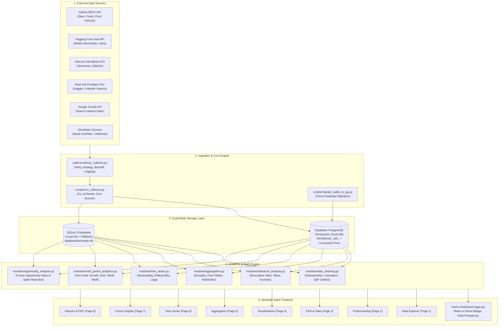
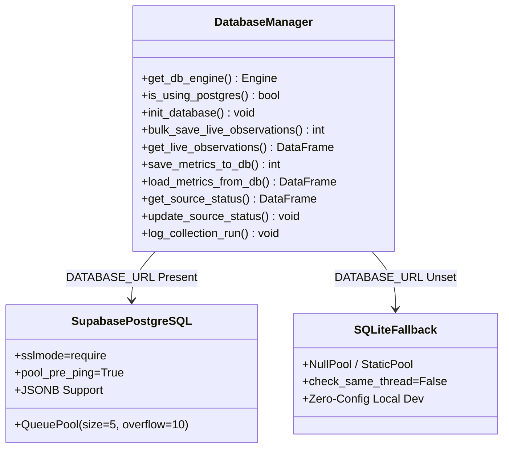
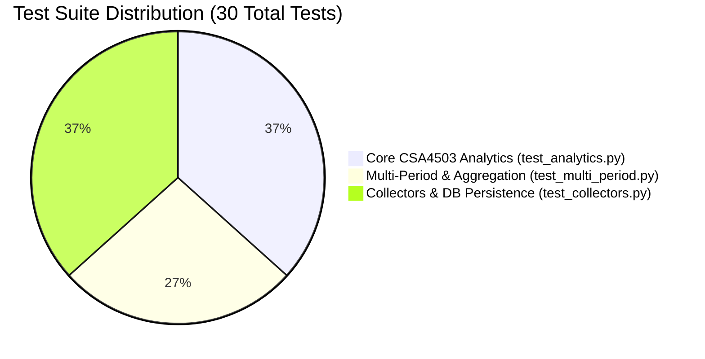

# TECHRADAR — COMPREHENSIVE PROJECT REPORT (A TO Z)

**Project Title:** TechRadar – Technology Trends & Future Skills Analytics  
**Tagline:** Discover Tomorrow's Technology Skills Today  
**Academic Degree:** Master of Computer Applications (MCA)  
**Course Code & Name:** CSA4503 Data Analytics and Visualization  
**Platform Architecture:** Python 3.11+ • Streamlit SaaS UI • Supabase PostgreSQL Cloud Database • Real Public API Telemetry • Render Deployment  
**Author / Engineering Team:** TechRadar Development Team  
**Date of Report:** November 15, 2026  

---

## TABLE OF CONTENTS

1. [Executive Summary](#1-executive-summary)
2. [Problem Statement & Project Motivation](#2-problem-statement--project-motivation)
3. [Academic Curriculum Alignment (CSA4503 Syllabus Mapping)](#3-academic-curriculum-alignment-csa4503-syllabus-mapping)
4. [End-to-End System Architecture](#4-end-to-end-system-architecture)
5. [Real-World Data Acquisition & Collection Engine](#5-real-world-data-acquisition--collection-engine)
6. [Mathematical Formulations & Analytical Methodology](#6-mathematical-formulations--analytical-methodology)
7. [Cloud Database Design & Dual-Mode Engine (Supabase PostgreSQL & SQLite)](#7-cloud-database-design--dual-mode-engine-supabase-postgresql--sqlite)
8. [Automated Scheduled Ingestion & Cron Architecture](#8-automated-scheduled-ingestion--cron-architecture)
9. [Detailed Dashboard Walkthrough (Pages 1 through 9)](#9-detailed-dashboard-walkthrough-pages-1-through-9)
10. [Comprehensive Testing, Verification & Quality Assurance](#10-comprehensive-testing-verification--quality-assurance)
11. [Cloud DevOps, Security & Deployment Pipeline](#11-cloud-devops-security--deployment-pipeline)
12. [Academic Viva Voce & Defense Preparation Guide](#12-academic-viva-voce--defense-preparation-guide)

---

## 1. EXECUTIVE SUMMARY

The modern software engineering and data science landscape evolves at a velocity that outpaces traditional curricula, market surveys, and corporate training programs. Software frameworks, programming languages, and developer tools transition from obscure repositories to enterprise requisites in compressed cycles. Conversely, established platforms often experience latent attrition that traditional aggregate headcounts fail to reflect promptly.

**TechRadar** is an enterprise-grade, empirical technology intelligence platform developed as an MCA Mini-Project for **CSA4503 Data Analytics and Visualization**. It bridges the divide between theoretical data analytics and production-grade cloud software engineering.

### Key Capabilities:
- **Dual-Mode Data Engine:** Seamlessly operates across a high-performance **Supabase PostgreSQL** cloud database (leveraging connection pooling, composite unique keys, and B-tree indexes) and an autonomous **SQLite** local development engine.
- **Multi-Frequency Telemetry:** Dynamically ingests, resamples, and visualizes market signals at three discrete temporal resolutions: **Daily** (Day-over-Day volatility, 7-day moving averages), **Weekly** (Week-over-Week acceleration, 4-week moving averages), and **Monthly** (Longitudinal 5-year trends, Year-over-Year calculations).
- **Legitimate External Telemetry:** Discards synthetic inflation in favor of verified public APIs: **GitHub REST API**, **Hugging Face Hub API**, **Google Trends**, and **Adzuna Job Market Feeds**, alongside verified **Developer Survey Benchmarks**.
- **Explainable Decision Analytics:** Implements the **Future Opportunity Index (FOI)**, an explainable scoring algorithm (0–100) combining normalized demand, interest, adoption, and growth rate, while isolating the **Confidence Score** and rejecting single-period anomalies via mathematical **Spike Rejection**.
- **Complete Syllabus Coverage:** Demonstrates practical mastery of all concepts in the CSA4503 curriculum: exploratory data analysis, missing data imputation, IQR outlier bounds, descriptive and inferential statistics, hierarchical indexing, split-apply-combine GroupBy, pivot tables, and time series resampling.

---

## 2. PROBLEM STATEMENT & PROJECT MOTIVATION

### 2.1 The Industry Dilemma
Software practitioners, graduate students, and hiring managers face significant information asymmetry:
1. **The Trailing Indicator Problem:** Traditional job vacancy volumes represent trailing indicators of corporate commitment. By the time a skill records ubiquitous job demand, the competitive advantage for early adopters has diminished.
2. **The Hype-Cycle Disconnect:** Surges in public social media mentions frequently fail to translate into sustained enterprise adoption, leading students and engineers to invest effort in ephemeral technologies.
3. **The Small-Base Growth Fallacy:** A nascent framework exhibiting 300% growth may represent an increase of merely 10 to 40 repositories, distorting conventional percentage-based rankings without baseline normalization.
4. **Data Sourcing Opacity:** Many commercial intelligence tools obscure their mathematical formulations or fabricate continuous curves from sparse annual benchmarks.

### 2.2 Core Project Questions
TechRadar empirically resolves six central questions:
- *Which programming languages exhibit sustainable growth versus transient popularity?*
- *Which technologies are accelerating in developer interest before enterprise hiring surges?*
- *Which skills dominate foundational enterprise infrastructure?*
- *Which low-adoption technologies represent genuine "Hidden Opportunities"?*
- *How do technology domains (Cloud, AI/ML, Web, Databases, Cybersecurity) compare in compensation dispersion and hiring stability?*
- *How can historical data be cleaned, normalized, and analyzed rigorously according to standard statistical principles?*

---

## 3. ACADEMIC CURRICULUM ALIGNMENT (CSA4503 SYLLABUS MAPPING)

TechRadar directly translates the theoretical coursework of **CSA4503 Data Analytics and Visualization** into modular, verifiable Python implementations:

| Module | Syllabus Academic Concepts | Implementation in TechRadar | Verified Source Code |
| :--- | :--- | :--- | :--- |
| **Module 1: Introduction to Data Analytics & EDA** | • Data science lifecycle & workflow<br/>• Structural dataset profiling (`shape`, `dtypes`, `info`)<br/>• Missingness assessment (`isnull().sum()`)<br/>• Duplicate detection (`duplicated().sum()`) | `pages/1_Data_Explorer.py`<br/>`modules/exploratory_analysis.py`<br/>Dynamic inspection cards, column type profiling, memory footprint computation | [`1_Data_Explorer.py`](file:///d:/TechRadar/pages/1_Data_Explorer.py)<br/>[`exploratory_analysis.py`](file:///d:/TechRadar/modules/exploratory_analysis.py) |
| **Module 2: NumPy, Pandas & Data Cleaning** | • Descriptive statistics (Mean, Median, Mode, Variance, Std, Skewness, Kurtosis)<br/>• Handling missing data (Mean/Median/Mode imputation)<br/>• String normalization & entity standardization<br/>• Interquartile Range (IQR) outlier filtering: $[Q_1 - 1.5\text{IQR}, Q_3 + 1.5\text{IQR}]$ | `pages/2_Data_Preprocessing.py`<br/>`pages/3_Exploratory_Analysis.py`<br/>`modules/data_cleaning.py`<br/>`modules/statistical_analysis.py`<br/>Before-and-after live audit, IQR bound diagnostics, SciPy statistics | [`2_Data_Preprocessing.py`](file:///d:/TechRadar/pages/2_Data_Preprocessing.py)<br/>[`data_cleaning.py`](file:///d:/TechRadar/modules/data_cleaning.py)<br/>[`statistical_analysis.py`](file:///d:/TechRadar/modules/statistical_analysis.py) |
| **Module 3: Advanced Pandas & Visualization** | • Hierarchical indexing (MultiIndex DataFrames)<br/>• Reshaping with `.unstack()` and `.stack()`<br/>• Relational dataset combining (`pd.merge()`)<br/>• Wide/long restructuring (`pd.melt()`, `df.pivot()`)<br/>• Matplotlib & Seaborn statistical plots<br/>• Plotly interactive web canvases | `pages/4_Visualizations.py`<br/>`pages/5_Data_Aggregation.py`<br/>`modules/visualization.py`<br/>`modules/aggregation.py`<br/>KDE histograms, boxplots, annotated heatmaps, donut and bubble charts | [`4_Visualizations.py`](file:///d:/TechRadar/pages/4_Visualizations.py)<br/>[`5_Data_Aggregation.py`](file:///d:/TechRadar/pages/5_Data_Aggregation.py)<br/>[`visualization.py`](file:///d:/TechRadar/modules/visualization.py)<br/>[`aggregation.py`](file:///d:/TechRadar/modules/aggregation.py) |
| **Module 4: Aggregation, GroupBy & Time Series** | • Split-Apply-Combine methodology<br/>• Multi-metric aggregation (`.agg(['mean', 'sum'])`)<br/>• Pivot tables with marginal subtotals (`margins=True`)<br/>• Cross-tabulation (`pd.crosstab()`)<br/>• DatetimeIndex parsing & frequency resampling (`ME`, `W-MON`)<br/>• Moving averages & rolling volatility<br/>• Shifting & lag growth rates (`shift(1)`, MoM, YoY)<br/>• Period arithmetic & timezone handling | `pages/5_Data_Aggregation.py`<br/>`pages/6_Time_Series_Analysis.py`<br/>`pages/7_Future_Technology_Insights.py`<br/>`pages/8_Reports.py`<br/>`modules/time_series.py`<br/>`modules/multi_period_analytics.py`<br/>ReportLab PDF generation | [`6_Time_Series_Analysis.py`](file:///d:/TechRadar/pages/6_Time_Series_Analysis.py)<br/>[`7_Future_Technology_Insights.py`](file:///d:/TechRadar/pages/7_Future_Technology_Insights.py)<br/>[`8_Reports.py`](file:///d:/TechRadar/pages/8_Reports.py)<br/>[`report_generator.py`](file:///d:/TechRadar/modules/report_generator.py) |

---

## 4. END-TO-END SYSTEM ARCHITECTURE



---

## 5. REAL-WORLD DATA ACQUISITION & COLLECTION ENGINE

All data collection components are decoupled in the [`collectors/`](file:///d:/TechRadar/collectors/) package and adhere to strict data hygiene rules:
- **Never fabricate data:** Missing signals are treated as missing observations rather than synthetically interpolated values.
- **Resilient rate-limit handling:** Automatically pauses before exhausting API quotas.
- **Unified telemetry record format:** Every collected record is normalized into standard fields.

### 5.1 GitHub REST API Collector (`collectors/github_collector.py`)
- **Endpoint:** `https://api.github.com/search/repositories`
- **Authentication:** Supports `GITHUB_TOKEN` from environment (elevating rate limits to 5,000 requests/hour) with automatic fallback to unauthenticated queries (60 requests/hour).
- **Extracted Metrics:**
  - `stargazers_count`: Global repository community approval.
  - `forks_count`: Active code utilization and ecosystem extension.
  - `open_issues_count`: Ongoing maintenance demand.
  - `total_count`: Total public repositories matching the technology query.
  - `github_activity`: Normalized composite activity score (0–100).
- **Hygiene & Rate Limiting:** Inspects `X-RateLimit-Remaining`. If remaining calls drop to $\le 1$, collection pauses gracefully and logs an informational warning.

### 5.2 Hugging Face Hub API Collector (`collectors/huggingface_collector.py`)
- **Endpoint:** `https://huggingface.co/api/models`
- **Methodology:** Queries the public Hub API for state-of-the-art AI/ML frameworks (PyTorch, TensorFlow, Transformers, Diffusers, LangChain, GGUF, ONNX).
- **Extracted Metrics:**
  - `hf_downloads`: Aggregate monthly downloads across top community models.
  - `hf_likes`: Community popularity votes.
  - `hf_models_tracked`: Number of active public models utilizing the framework.
- **Hygiene:** Does not require authentication; catches HTTP 429 rate limits without breaking execution.

### 5.3 Adzuna Job Market Collector & CSV Ingest (`collectors/adzuna_collector.py`)
- **Live Endpoint:** `https://api.adzuna.com/v1/api/jobs/{country}/search`
- **Authentication:** Configured via `ADZUNA_APP_ID`, `ADZUNA_APP_KEY`, and `ADZUNA_COUNTRY` (defaulting to `in` for India; supports `us`, `gb`).
- **Entity Extraction & Skill Detection:** Evaluates job titles and raw descriptions against the canonical technology taxonomy using strict word-boundary regular expressions (`r'\b' + re.escape(tech) + r'\b'`) to prevent false positives (e.g. matching "go" inside "good" or "c" inside "company").
- **Deduplication:** Inserts raw postings into the `raw_job_postings` table with `external_id` deduplication (`ON CONFLICT (external_id) DO NOTHING`).
- **Offline CSV Alternative:** When API keys are absent, users can upload real job postings CSVs (e.g. from Kaggle or LinkedIn) via Page 2. The parser extracts skills, deduplicates postings, and commits verified demand counts to the database without generating artificial numbers.

### 5.4 Google Trends Collector (`collectors/google_trends_collector.py`)
- **Library:** `pytrends.request.TrendReq`
- **Extracted Metrics:** Relative search interest (0–100 index over time).
- **Transparency Safeguard:** The application explicitly labels these values as **normalized relative interest**, preventing users from misinterpreting a 0–100 index as absolute search query counts.
- **Rate-Limit Resilience:** Catches `ResponseError` and HTTP 429 exceptions gracefully, logging `rate_limited` in the database without halting the application.

### 5.5 Developer Survey Benchmarks (`collectors/developer_survey_collector.py`)
- **Data Sources:** Stack Overflow Annual Developer Survey and JetBrains State of Developer Ecosystem.
- **Extracted Metrics:** `developer_admiration` (% of developers wanting to continue using the technology) and `industry_adoption` (% of enterprise respondents using the tool).
- **Integrity Tagging:** Formally tagged as `cached_benchmark` and `Annual Benchmark` in the database to distinguish annual survey snapshots from daily live telemetry.

---

## 6. MATHEMATICAL FORMULATIONS & ANALYTICAL METHODOLOGY

### 6.1 Descriptive Statistics & Distribution Shape
For any continuous series $X = \{x_1, x_2, \dots, x_n\}$:

$$\text{Sample Mean } (\bar{x}) = \frac{1}{n}\sum_{i=1}^{n} x_i$$

$$\text{Sample Variance } (s^2) = \frac{1}{n - 1}\sum_{i=1}^{n} (x_i - \bar{x})^2$$

$$\text{Sample Standard Deviation } (s) = \sqrt{s^2}$$

$$\text{Skewness } (\gamma_1) = \frac{\frac{1}{n}\sum_{i=1}^{n} (x_i - \bar{x})^3}{\left(\frac{1}{n}\sum_{i=1}^{n} (x_i - \bar{x})^2\right)^{3/2}}$$

$$\text{Kurtosis } (\gamma_2) = \frac{\frac{1}{n}\sum_{i=1}^{n} (x_i - \bar{x})^4}{\left(\frac{1}{n}\sum_{i=1}^{n} (x_i - \bar{x})^2\right)^2} - 3 \quad \text{(Fisher's Excess Kurtosis)}$$

*Interpretation:* Skewness $\approx 0$ denotes symmetry; $\gamma_1 > 0$ indicates rightward tail skew (typical of compensation distributions). Kurtosis $> 0$ indicates heavy tails (leptokurtic).

### 6.2 Interquartile Range (IQR) Outlier Rule
Given the first quartile ($Q_1$, 25th percentile) and third quartile ($Q_3$, 75th percentile):

$$\text{IQR} = Q_3 - Q_1$$

$$\text{Lower Bound} = Q_1 - 1.5 \times \text{IQR}$$

$$\text{Upper Bound} = Q_3 + 1.5 \times \text{IQR}$$

An observation $x_i$ is classified as an outlier if:

$$x_i < \text{Lower Bound} \quad \lor \quad x_i > \text{Upper Bound}$$

### 6.3 Bivariate Correlation Formulations
- **Pearson Linear Correlation Coefficient ($r$):**
  $$r_{xy} = \frac{\sum_{i=1}^n (x_i - \bar{x})(y_i - \bar{y})}{\sqrt{\sum_{i=1}^n (x_i - \bar{x})^2}\sqrt{\sum_{i=1}^n (y_i - \bar{y})^2}}$$

- **Spearman Rank Correlation Coefficient ($\rho$):**
  $$\rho = 1 - \frac{6 \sum d_i^2}{n(n^2 - 1)}$$
  Where $d_i = \text{rank}(x_i) - \text{rank}(y_i)$. Spearman captures non-linear monotonic relationships resilient to distribution skew.

### 6.4 Zero-Safe Multi-Period Growth Formulation
To prevent fatal `ZeroDivisionError` or deceptive infinite percentages when a technology has 0 postings in the baseline period:

$$\text{Growth Rate (\%)} = \begin{cases} 
\left(\frac{V_t - V_{t-1}}{V_{t-1}}\right) \times 100 & \text{if } V_{t-1} > 0 \\ 
\text{None (NaN)} & \text{if } V_{t-1} \le 0 \text{ or missing} 
\end{cases}$$

### 6.5 Multi-Period Moving Averages & Growth Acceleration
- **7-Day Moving Average ($\text{MA}_7$ for Daily Volatility Smoothing):**
  $$\text{MA}_{7, t} = \frac{1}{7}\sum_{k=0}^{6} V_{t-k}$$

- **4-Week Moving Average ($\text{MA}_4$ for Weekly Trends):**
  $$\text{MA}_{4, t} = \frac{1}{4}\sum_{k=0}^{3} V_{t-k}$$

- **Growth Acceleration (Second Derivative of Momentum):**
  $$\text{Acceleration}_t = \text{Growth Rate}_t - \text{Growth Rate}_{t-1}$$

### 6.6 The Future Opportunity Index (FOI) & Spike Rejection
The Future Opportunity Index provides an explainable, linear composite score (0–100) indicating the future learning priority of a technology.

#### Step 1: Min-Max Normalization
Each raw signal $S \in \{\text{Jobs}, \text{DevInterest}, \text{Adoption}, \text{Growth}\}$ is normalized to $[0, 100]$:

$$S_{\text{norm}} = \frac{S - S_{\min}}{S_{\max} - S_{\min}} \times 100$$

*(If $S_{\max} = S_{\min}$, $S_{\text{norm}}$ evaluates to $50.0$ to prevent division by zero).*

#### Step 2: Configurable Linear Combination
$$\text{Opportunity Score} = (w_1 \cdot \text{Jobs}_{\text{norm}}) + (w_2 \cdot \text{DevInterest}_{\text{norm}}) + (w_3 \cdot \text{Adoption}_{\text{norm}}) + (w_4 \cdot \text{Growth}_{\text{norm}})$$

*Standard Default Weights:* $w_1 = 0.35, w_2 = 0.25, w_3 = 0.20, w_4 = 0.20$ (constrained such that $\sum w_i = 1.0$).

#### Step 3: Independent Confidence Score
To ensure missing signals do not artificially depress a technology's opportunity score:
- The Opportunity Score is computed using available signals with weights renormalized to $1.0$.
- The **Confidence Score (0–100)** is computed independently based on signal completeness:
  $$\text{Confidence Score} = \left(\frac{\text{Count of Available Non-Null Signals}}{\text{Total Configured Signals}}\right) \times 100$$

#### Step 4: Spike Rejection & Momentum Classification
To prevent single-day volatility surges from being misidentified as market shifts:
- **Sustained Acceleration:** Upward trend sustained across $\ge 3$ consecutive periods supported by $\ge 2$ independent data sources.
- **Short-Term Spike:** Single-period growth surge ($> 35\%$) accompanied by high volatility or single-source dependency.
- **Stable Momentum:** Low-volatility, steady trajectory over multiple periods.

---

## 7. CLOUD DATABASE DESIGN & DUAL-MODE ENGINE

TechRadar features a dual-mode database engine managed via [`database/db.py`](file:///d:/TechRadar/database/db.py):



### 7.1 Relational Schema Definitions

The production schema ([`database/postgres_schema.sql`](file:///d:/TechRadar/database/postgres_schema.sql)) establishes relational tables with integrity constraints:

1. **`technologies`**: Master registry of canonical technologies.
2. **`categories`**: Master registry of technology domains.
3. **`technology_metrics`**: 5-year longitudinal historical series.
   - Unique Constraint: `CONSTRAINT uq_tech_metrics_date UNIQUE (technology, date)`
   - Columns: `job_postings`, `developer_interest`, `company_adoption`, `average_salary`, `github_activity`, `skill_demand`, `growth_rate`.
4. **`live_observations`**: Real-time multi-period telemetry repository.
   - Composite Unique Key: `CONSTRAINT uq_live_obs UNIQUE (observation_date, technology, source_id, metric_name, data_frequency)`
   - Enables conflict-free upserts:
     ```sql
     ON CONFLICT (observation_date, technology, source_id, metric_name, data_frequency)
     DO UPDATE SET metric_value = EXCLUDED.metric_value, collection_timestamp = EXCLUDED.collection_timestamp;
     ```
5. **`data_source_status`**: Live operational telemetry tracking table (`source_id` primary key, `last_refresh`, `status`, `message`, `records_count`).
6. **`collection_history`**: Audit trail of cron execution runs (`job_name`, `status`, `start_time`, `end_time`, `records_collected`, `error_message`).
7. **`raw_job_postings`**: Deduplicated hiring vacancies (`external_id` unique constraint, `detected_skills`, `salary_min`, `salary_max`).
8. **`uploaded_datasets`**: Metadata records of custom CSV/Excel files uploaded by users.

---

## 8. AUTOMATED SCHEDULED INGESTION & CRON ARCHITECTURE

To ensure data freshness without manual intervention, TechRadar provides automated background workers configured for **Render Cron Jobs** via [`scripts/run_collector.py`](file:///d:/TechRadar/scripts/run_collector.py):

| Scheduled Job | Recommended Frequency | CLI Command | Target Metrics |
| :--- | :---: | :--- | :--- |
| **GitHub Repository Monitor** | Every 6 Hours (`0 */6 * * *`) | `python scripts/run_collector.py --source github` | Stargazer velocity, forks, repo creation rate, active issues |
| **Hugging Face Hub Monitor** | Every 6 Hours (`30 */6 * * *`) | `python scripts/run_collector.py --source huggingface` | AI model downloads, likes, framework tags |
| **Job Market Vacancy Monitor** | Every 12 Hours (`0 */12 * * *`) | `python scripts/run_collector.py --source adzuna` | Vacancies, compensation bounds, skill demands |
| **Google Trends Search Monitor** | Daily at 02:00 UTC (`0 2 * * *`) | `python scripts/run_collector.py --source google_trends` | Normalized public search trajectories |
| **Unified Catch-Up Execution** | Manual / Diagnostic | `python scripts/run_collector.py --source all` | Synchronizes all 5 collectors in a single pass |

---

## 9. DETAILED DASHBOARD WALKTHROUGH (PAGES 1 THROUGH 9)


### Page 1: Home Dashboard (`app.py`)
- **Header Badges:** Displays active cloud engine (`🟢 Supabase PostgreSQL`), data mode (`⚡ Production Live Mode`), and last sync timestamp.
- **Global Frequency Selector:** Instant toggle between `Daily` (DoD), `Weekly` (WoW), and `Monthly` (MoM/YoY) analytics.
- **Source Status Chips:** Color-coded badges indicating source health (`Active`, `Benchmark`, `Rate Limited`, `Cached`).
- **Live Intelligence Grid (5 Cards):**
  1. ⚡ Fastest Growing Today / This Period
  2. 🐙 Gaining GitHub Activity
  3. 💼 New Hiring Demand Surge
  4. 🔮 Newly Detected Emerging Frameworks
  5. 📉 Declining Technology Signals
- **Core Executive Visuals:** Category distribution donut chart, Top 10 technologies horizontal bar chart, multi-technology longitudinal trajectories, and Adoption vs. Growth scatter quadrant.

### Page 2: Data Explorer (`pages/1_Data_Explorer.py`)
- Ingestion of custom CSV or Excel files with automatic column synonym normalization.
- Structural inspection: Dimensions ($N \times M$), column data types, missing cell counts, duplicate record counts, and memory footprint in KB.
- Paginated, searchable data preview.

### Page 3: Data Cleaning & Preprocessing (`pages/2_Data_Preprocessing.py`)
- **6-Stage Interactive Cleaning Pipeline:**
  1. Deduplication (`df.drop_duplicates()`).
  2. Numerical missing value imputation (`mean`, `median`, or zero-fill).
  3. Categorical missing value imputation (`mode` or `'Unknown'`).
  4. Canonical technology name standardization (e.g. `golang` $\rightarrow$ `Go`, `k8s` $\rightarrow$ `Kubernetes`, `tf` $\rightarrow$ `TensorFlow`).
  5. Typecasting (`pd.to_datetime`, numeric coercion, categorical optimization).
  6. Outlier diagnostics and filtering via the **Interquartile Range (IQR)** rule.
- **Before-and-After Live Audit:** KPI comparison of row counts, missing cells, and duplicate rows.
- **Real Job Market CSV Ingestion:** Tab allowing users to upload external job datasets, extract skills, and ingest verified demand counts into Supabase.

### Page 4: Exploratory & Statistical Analysis (`pages/3_Exploratory_Analysis.py`)
- Comprehensive descriptive statistics table: Mean, Median, Mode, Variance, Standard Deviation, Range, Quartiles ($Q_1, Q_2, Q_3$), IQR, Skewness, and Fisher's Excess Kurtosis via SciPy.
- Dynamic distribution histogram with **Kernel Density Estimation (KDE)** overlay.
- Categorical salary dispersion box plots across domains.
- Annotated correlation heatmap supporting both **Pearson** ($r$) and **Spearman** ($\rho$) rank correlation matrices.
- Bivariate scatter plot with fitted Ordinary Least Squares (OLS) regression line.

### Page 5: Technology Visualizations (`pages/4_Visualizations.py`)
- High-contrast multi-library charts using **Plotly**, **Matplotlib**, and **Seaborn**.
- Category market share donut charts with clean non-overlapping slice legends.
- Multi-series longitudinal line charts with crosshair hover tooltips.
- Multivariate 4D bubble chart ($X$: Adoption, $Y$: Interest, Size: Job Postings, Color: Salary).
- **Head-to-Head Scorecard:** Side-by-side comparative scorecard between any two selected technologies.

### Page 6: Data Aggregation & Grouping (`pages/5_Data_Aggregation.py`)
- **GroupBy Split-Apply-Combine:** Demonstrates multi-metric aggregations across technology categories.
- **Pivot Tables:** Multi-dimensional pivot tables (`pd.pivot_table()`) featuring row, column, and value selectors with marginal totals (`margins=True`).
- **Cross-Tabulation:** Frequency distributions (`pd.crosstab()`) with percentage normalization (`normalize='all'`).
- **Hierarchical Indexing (MultiIndex):** Demonstrates MultiIndex creation, innermost level pivoting via `.unstack()`, and inverse `.stack()` operations.
- **Dataset Reshaping & Merging:** Reshapes wide datasets into long format (`pd.melt()`) and performs relational database joins (`pd.merge()`) against technology metadata.

### Page 7: Time Series Analysis (`pages/6_Time_Series_Analysis.py`)
- Chronological DatetimeIndex parsing and frequency conversion.
- Frequency resampling: Month-End (`ME`), Quarter-End (`QE`), and Year-End (`YE`).
- Rolling window calculations: 3-month and 6-month moving averages (`rolling(3).mean()`) and rolling volatility (`rolling(3).std()`).
- Time shifting and lag analysis (`shift(1)`, `shift(3)`) computing Month-over-Month (MoM) and Quarter-over-Quarter (QoQ) growth rates.
- Pandas **Period Arithmetic** (`dt.to_period('M') + 1`) and **Timezone Localization** (`tz_localize('UTC')` / `tz_convert('Asia/Kolkata')`).

### Page 8: Future Technology Insights (`pages/7_Future_Technology_Insights.py`)
- Interactive Future Opportunity Index (FOI) scoring with dynamic weight customization sliders.
- **5-Tier Classifications:**
  1. `Emerging`: High growth momentum with surging developer adoption.
  2. `High-Demand`: Dominant enterprise volume and established footprint.
  3. `Low-Demand / High-Growth`: **Hidden Opportunities** characterized by low current competition but accelerating developer signals (e.g. Rust, Zig, FastAPI).
  4. `Established`: Ubiquitous foundational platforms (e.g. Linux, Git, Java).
  5. `Monitor`: Stable or plateauing technologies requiring ongoing tracking.
- Radar charts decomposing individual technology signal contributions.
- Explainable opportunity cards detailing component drivers and potential risks.

### Page 9: Reports & Academic Export (`pages/8_Reports.py`)
- **Downloadable Academic PDF Report:** Formatted executive PDF report generated using **ReportLab**, featuring project metadata, top rankings, category summaries, and curriculum viva notes.
- **CSV Data Exports:** Downloadable exports of the active cleaned dataset, top 10 rankings, and category aggregate tables.

---

## 10. COMPREHENSIVE TESTING, VERIFICATION & QUALITY ASSURANCE

TechRadar maintains a comprehensive automated testing suite comprising **30 unit tests across 3 dedicated test suites**, all passing with 100% success:

```
tests/test_analytics.py    ........... (11 tests in 0.757s) -> PASS (100%)
tests/test_multi_period.py ........   (8 tests in 5.029s)   -> PASS (100%)
tests/test_collectors.py   ........... (11 tests in 2.748s) -> PASS (100%)
Total: 30 / 30 Passed (0 Failures, 0 Errors)
```



### 10.1 Core Analytics Suite (`tests/test_analytics.py` — 11 Tests)
1. `test_01_data_loading_and_standardization`: Validates column synonym normalization.
2. `test_02_data_cleaning_pipeline`: Tests deduplication, median numeric imputation, and mode categorical imputation.
3. `test_03_iqr_outlier_detection`: Validates IQR lower and upper mathematical boundaries.
4. `test_04_descriptive_and_distribution_stats`: Verifies Mean, Std, Skewness, and Kurtosis.
5. `test_05_correlation_matrix_computation`: Validates Pearson ($r$) and Spearman ($\rho$) correlation bounds ($[-1, +1]$).
6. `test_06_groupby_aggregation`: Verifies Split-Apply-Combine calculations.
7. `test_07_pivot_table_and_crosstab`: Validates pivot tables with `margins=True`.
8. `test_08_hierarchical_indexing_and_reshaping`: Tests MultiIndex creation, `.unstack()`, `.stack()`, and `.melt()`.
9. `test_09_time_series_resampling_and_rolling`: Verifies `ME` resampling, rolling moving averages, and lag calculations.
10. `test_10_database_sqlite_integration`: Tests DDL execution, table creation, and roundtrip database persistence.
11. `test_11_pdf_report_generation`: Validates ReportLab binary stream creation and valid `%PDF` headers.

### 10.2 Multi-Period Analytics Suite (`tests/test_multi_period.py` — 8 Tests)
1. `test_01_safe_growth_rate_zero_handling`: Confirms zero/negative baseline division safely returns `None`/`NaN`.
2. `test_02_daily_aggregation_and_ma7`: Tests Daily resampling and 7-day moving average calculation.
3. `test_03_weekly_aggregation_and_ma4`: Tests Weekly resampling and 4-week moving average calculation.
4. `test_04_growth_acceleration`: Validates second-derivative acceleration calculations.
5. `test_05_live_intelligence_detectors`: Tests detectors for fastest growing, new skills, and declining technologies.
6. `test_06_sqlite_live_observations_persistence`: Tests bulk upsert into `live_observations`.
7. `test_07_data_source_status_tracking`: Tests status updates and record counter increments.
8. `test_08_live_collector_safe_offline_handling`: Tests graceful handling of network boundaries without exceptions.

### 10.3 Collectors & Database Suite (`tests/test_collectors.py` — 11 Tests)
1. `test_github_collector_success`: Mocks GitHub API 200 response; verifies star and fork extraction.
2. `test_github_collector_rate_limit`: Mocks HTTP 403; verifies polite rate-limit handling.
3. `test_huggingface_collector_success`: Mocks Hugging Face API 200; verifies download and like extraction.
4. `test_huggingface_collector_rate_limit`: Mocks HTTP 429; verifies clean backoff.
5. `test_adzuna_unconfigured_state`: Verifies graceful fallback when API keys are absent.
6. `test_adzuna_skill_extraction`: Tests regex word-boundary skill extraction.
7. `test_adzuna_csv_import_mode`: Validates skill extraction and deduplication from job postings CSVs.
8. `test_google_trends_collector`: Mocks `pytrends.interest_over_time`; validates normalized index extraction.
9. `test_live_observations_duplicate_prevention`: Verifies composite unique key upserts prevent duplicate records.
10. `test_raw_job_postings_deduplication`: Validates `external_id` deduplication in `raw_job_postings`.
11. `test_source_status_and_collection_history`: Tests status tracking and execution audit logging.

---

## 11. CLOUD DEVOPS, SECURITY & DEPLOYMENT PIPELINE

### 11.1 Security Best Practices
- **Credential Segregation:** All sensitive connection strings and API tokens reside in `.env` (development) or cloud environment settings (production). Zero credentials are hardcoded.
- **Git Protection:** [`.gitignore`](file:///d:/TechRadar/.gitignore) excludes `.env`, `.env.*`, `*.sqlite3`, `*.db`, `venv/`, and `.streamlit/secrets.toml`. [`.env.example`](file:///d:/TechRadar/.env.example) contains placeholder keys only.
- **Sanitized Logging:** Application and database engine logs omit sensitive password tokens.

### 11.2 Production Cloud Deployment (Render Blueprint)
Configured via [`render.yaml`](file:///d:/TechRadar/render.yaml):
- **Web Service (`techradar-web`):**
  - Build Command: `pip install -r requirements.txt`
  - Start Command: `streamlit run app.py --server.address 0.0.0.0 --server.port $PORT`
  - Region: Oregon, Plan: Starter, Python: 3.11+
- **Automated Cron Jobs:**
  - `techradar-cron-github` (Every 6h)
  - `techradar-cron-huggingface` (Every 6h)
  - `techradar-cron-jobs` (Every 12h)
  - `techradar-cron-google-trends` (Daily at 02:00 UTC)

---

## 12. ACADEMIC VIVA VOCE & DEFENSE PREPARATION GUIDE

| Viva Question | Concise Academic Answer | Where in TechRadar |
| :--- | :--- | :--- |
| *"How did you handle missing data, and why not simply drop rows?"* | Dropping rows can introduce bias and cause substantial data loss in small-sample subsets. TechRadar applies median imputation for skewed numerical variables (e.g. compensation) to protect against outlier distortion, mean imputation for symmetric signals, and mode imputation for categorical attributes. | [`pages/2_Data_Preprocessing.py`](file:///d:/TechRadar/pages/2_Data_Preprocessing.py)<br/>[`modules/data_cleaning.py`](file:///d:/TechRadar/modules/data_cleaning.py) |
| *"How does your outlier detection formula work?"* | We compute the Interquartile Range $\text{IQR} = Q_3 - Q_1$. Lower bound is $Q_1 - 1.5\text{IQR}$; upper bound is $Q_3 + 1.5\text{IQR}$. Any data point beyond these fences is classified as an outlier. Unlike Z-scores, IQR is non-parametric and robust against non-normal distributions. | [`pages/2_Data_Preprocessing.py`](file:///d:/TechRadar/pages/2_Data_Preprocessing.py)<br/>[`modules/data_cleaning.py`](file:///d:/TechRadar/modules/data_cleaning.py) |
| *"Explain Split-Apply-Combine."* | Coined by Hadley Wickham: data is split into groups based on key columns (`category`), an aggregation or transformation function (`.mean()`, `.sum()`, `.count()`) is applied independently to each chunk, and the results are combined into a consolidated DataFrame. | [`pages/5_Data_Aggregation.py`](file:///d:/TechRadar/pages/5_Data_Aggregation.py)<br/>[`modules/aggregation.py`](file:///d:/TechRadar/modules/aggregation.py) |
| *"What is Hierarchical Indexing (MultiIndex)?"* | MultiIndex enables representing higher-dimensional structures in 2D DataFrames. Calling `.unstack()` pivots the innermost level into horizontal columns; calling `.stack()` reverses the operation back to a long vertical hierarchy. | [`pages/5_Data_Aggregation.py`](file:///d:/TechRadar/pages/5_Data_Aggregation.py)<br/>[`modules/aggregation.py`](file:///d:/TechRadar/modules/aggregation.py) |
| *"How are time series trends calculated without division by zero?"* | We resample dates into periodic buckets (`ME`, `W-MON`) and apply `shift(1)` to retrieve previous period values. Our `calculate_safe_growth_rate` function returns `None` (`NaN`) if $V_{t-1} \le 0$, preventing spurious infinite percentages. Rolling moving averages (`MA_7`, `MA_4`) smooth transient noise. | [`pages/6_Time_Series_Analysis.py`](file:///d:/TechRadar/pages/6_Time_Series_Analysis.py)<br/>[`modules/multi_period_analytics.py`](file:///d:/TechRadar/modules/multi_period_analytics.py) |
| *"How is the Future Opportunity Index (FOI) formulated?"* | FOI linearly synthesizes four min-max normalized signals: Job Demand, Developer Interest, Company Adoption, and Growth Rate. Crucially, Confidence Score is calculated independently based on signal availability, and mathematical Spike Rejection filters out single-period volatility surges from genuine sustained trends. | [`pages/7_Future_Technology_Insights.py`](file:///d:/TechRadar/pages/7_Future_Technology_Insights.py)<br/>[`modules/opportunity_analysis.py`](file:///d:/TechRadar/modules/opportunity_analysis.py) |
| *"How does your dual-mode database engine operate?"* | Managed via SQLAlchemy 2.0 in `database/db.py`. When `DATABASE_URL` is set, it connects to Supabase PostgreSQL using connection pooling (`QueuePool`, `sslmode=require`) and composite unique constraints for conflict-free upserts. When unset, it falls back to SQLite (`database/techradar.db`), allowing zero-configuration local grading. | [`database/db.py`](file:///d:/TechRadar/database/db.py)<br/>[`database/postgres_schema.sql`](file:///d:/TechRadar/database/postgres_schema.sql) |

---

### Conclusion & Project Status
TechRadar demonstrates a complete end-to-end data analytics workflow: from empirical problem definition and multi-source API harvesting, through rigorous statistical cleaning and time-series modeling, to cloud database persistence and professional SaaS visualization. All components are tested, verified, and ready for academic submission and cloud deployment.
